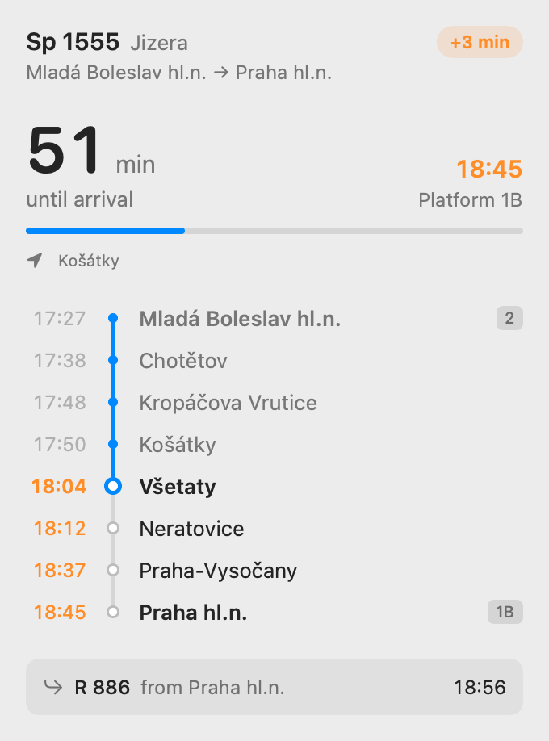

# TrainAlarm

A macOS menu bar app that shows your current train ride: live delay, countdown to departure or arrival, platform and the stops ahead.



## Sources

- **Můj vlak (České dráhy)** — sign in once with your ČD e-shop e-mail and password. Your tickets are read from the account, and the ride in progress (or the next one) loads automatically with live position and delay. Credentials are stored in the macOS Keychain.
- **[IDOS](https://idos.cz) link** — paste a shared connection link to track a ride that isn't on your ČD account. It takes over until you stop tracking it (⋯ menu).

The ČD integration uses the Můj vlak app's back-end (IPWS). Its reverse-engineered docs live in [`mujvlak/`](mujvlak/openapi.yaml). One quirk worth knowing: `/Date(ms)/` timestamps are Prague wall-clock time encoded as if they were UTC.

## Build from source

Requires macOS 14+ and Xcode (or the Command Line Tools: `xcode-select --install`).

```bash
swift run                      # run from the terminal
swift test                     # unit tests
./scripts/package-app.sh       # build, bundle and install to /Applications
```

The packaged app is ad-hoc signed, so after reinstalling a new build macOS may ask once to let TrainAlarm read its Keychain item. Choose *Always Allow*.

To regenerate the screenshot: `TRAINALARM_SNAPSHOT=image.png swift run`.

## Layout

- `Sources/TrainAlarmKit` — ride model, ČD IPWS client (`CeskeDrahy/`), IDOS scraper (`Idos/`), Keychain storage
- `Sources/TrainAlarm` — SwiftUI menu bar app
- `Tests/TrainAlarmKitTests` — tests against a recorded live train response
