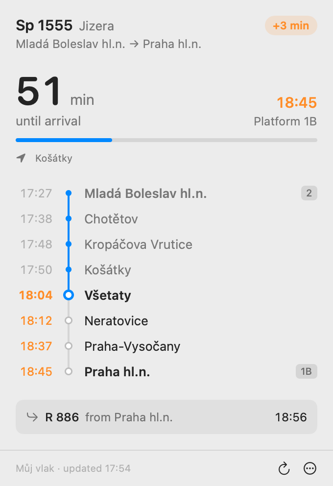
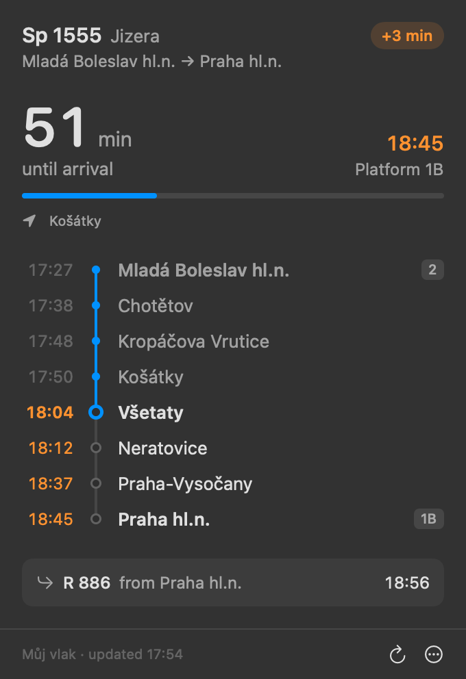
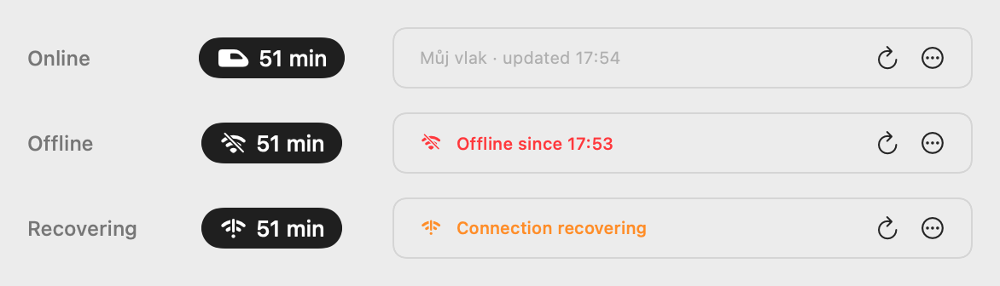

# TrainAlarm

A macOS menu bar app that shows your current train ride: live delay, countdown to departure or arrival, platform and the stops ahead.

<p>
  
  
</p>

The menu bar shows a countdown (clock icon before departure, train icon on board), so you rarely need to open the window.

## Sources

- **Můj vlak (České dráhy)** — sign in once with your ČD e-shop e-mail and password. Your tickets are read from the account, and the ride in progress (or the next one) loads automatically with live position and delay. Credentials are stored in the macOS Keychain.
- **[IDOS](https://idos.cz) link** — paste a shared connection link to track a ride that isn't on your ČD account. It takes over until you stop tracking it (⋯ menu).

## Connection indicator

Built for spotty connections and phone hotspots on the go.



- **Online** — the internet is checked every 15 s (`cp.cloudflare.com/generate_204`, which also catches captive portals).
- **Offline** — one failed or slow (>5 s) check swaps the menu bar icon for a crossed-out Wi-Fi; checks run every 3 s.
- **Recovering** — after the first successful check, checks back off (1, 2, 4, 8 s). Any failure goes back to offline; 15 s without one clears the icon and refreshes the ride.

## Build from source

Requires macOS 14+ and Xcode (or the Command Line Tools: `xcode-select --install`).

```bash
swift run                      # run from the terminal
swift test                     # unit tests
./scripts/package-app.sh       # build, bundle and install to /Applications
```

The packaged app is ad-hoc signed, so after reinstalling a new build macOS may ask once to let TrainAlarm read its Keychain item. Choose *Always Allow*.

To regenerate the screenshots from sample data: `TRAINALARM_SNAPSHOTS=docs/screenshots swift run`.

## Notes

The ČD integration uses the Můj vlak app's back-end (IPWS). Its reverse-engineered docs live in [`mujvlak/`](mujvlak/openapi.yaml). One quirk worth knowing: `/Date(ms)/` timestamps are Prague wall-clock time encoded as if they were UTC.

## Layout

- `Sources/TrainAlarmKit` — ride model, ČD IPWS client (`CeskeDrahy/`), IDOS scraper (`Idos/`), connectivity state machine, Keychain storage
- `Sources/TrainAlarm` — SwiftUI menu bar app
- `Tests/TrainAlarmKitTests` — tests for date handling, ticket mapping, trip selection, a recorded live train response and the connectivity schedule
